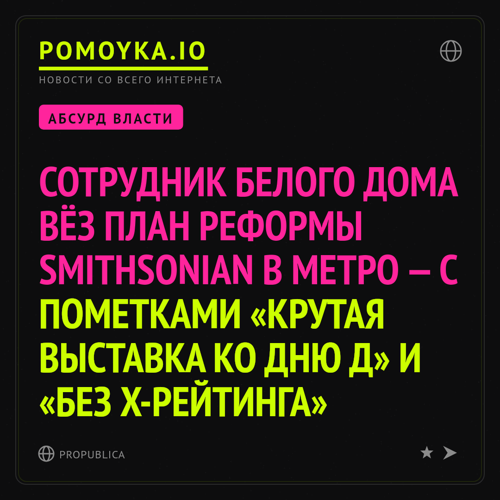

# «Абсурд власти» — выпуск

Неделя с 27 ноября (пятница 12:00 UTC). Собрано 2026-11-27 15:06 UTC. Ждёт «да» владельца.

**Заголовок:** Сотрудник Белого дома вёз план реформы Smithsonian в метро — с пометками «крутая выставка ко Дню Д» и «без X-рейтинга»

**Текст:** Как выяснила ProPublica, в конце октября пассажир оранжевой линии метро Вашингтона сфотографировал через плечо соседа экран его ноутбука, где был открыт документ «Smithsonian Institution Renewal Plan». Черновик был ещё в работе: на отдельном листе, тоже на виду, от руки были приписаны пункты «announce exciting cool exhibit on D-Day» и «no X rated exhibitions policy». В основном списке на 25 пунктов — увольнение директора музея и дюжины других администраторов и кураторов, новые постоянные экспозиции и статуя Джорджа Вашингтона у входа. То, что такой план возят в метро на всеобщем обозрении, — форменный пиздец.

**Деталь:** Черновик плана реформы Smithsonian, который сотрудник Белого дома вёз в метро, был ещё в работе: на отдельном листе у него были приписаны пункты “announce exciting cool exhibit on D-Day” и “no X rated exhibitions policy”.

**Цитата** (найдена в тексте статьи): «The plan was apparently still a work in progress, given that the staffer had scribbled other proposals on a sheet of paper, also in plain view. They included “announce exciting cool exhibit on D-Day” and “no X rated exhibitions policy.”»

**Источник:** ProPublica — https://www.propublica.org/article/dc-metro-smithsonian-american-history-plan

Рерайт: переписан повторно; нарушения: слишком длинно, нужен один абзац до 4 предложений.

## Как выбирали

Материалов за 7 дней: 70 (BBC — US & Canada — 25, The New Yorker — News — 14, NPR — Politics — 12, Rolling Stone — Politics — 9, ProPublica — 10).

Оценки отбора: «7» — 1, «6» — 2, «5» — 2, «4» — 1, «3» — 5, «2» — 11, «1» — 36, «0» — 12.

| Оценка | Издание | Заголовок | Почему |
|---|---|---|---|
| 7 | NPR — Politics | U.S. Judge rules FCC violated ABC's free speech rights to please Trump | Федеральный суд зафиксировал, что FCC пыталась пересмотреть все лицензии ABC, чтобы угоди… |
| 6 | NPR — Politics | Storms disrupt Thanksgiving travel. And, FCC violated ABC's free speech, judge says | Суд зафиксировал, что регулятор связи наказал телевещателя за сатиру, не понравившуюся пр… |
| 6 | ProPublica | Spotted on the D.C. Metro: Trump Staffer Accidentally Reveals Plan for Smithsonian Overhaul | Сотрудник случайно раскрыл план перестройки Смитсоновского института, засветив документ в… |
| 5 | BBC — US & Canada | Trump's accounts traded Nvidia shares 44 times this year, records show | Согласно финансовым декларациям, счета действующего президента 44 раза за год торговали а… |
| 5 | NPR — Politics | Jensen Huang returns to Nvidia. And, Rep. Gomez resigns amid alleged sexual misconduct | Трамп публично записал себе в заслугу «переговоры» о возвращении в Nvidia гендиректора Дж… |
| 4 | Rolling Stone — Politics | Donald Trump Rants About ‘Radical Far Left,’ Ballroom Critics in Thanksgiving Post | В официальном праздничном посте — странная благодарность, что преступники «в основном исч… |
| 3 | BBC — US & Canada | US Army says controlled blast of explosives in Iowa was 'huge success' | Контролируемый взрыв называют «огромным успехом», но это скорее рутинное официальное заяв… |
| 3 | NPR — Politics | Court lets Puerto Rico governor fire firm that runs the island's troubled power grid | Суд разрешил губернатору расторгнуть контракт оператора энергосети — это юридическая ново… |
| 3 | BBC — US & Canada | Musk's plan to send a million SpaceX data satellites into space approved | Дикая цифра — миллион спутников ради ИИ, но это техно-бизнес-новость об одобрении частног… |
| 3 | BBC — US & Canada | Trump's rescue of Nvidia's Huang brings political risks | Материал — анализ политических рисков, а не задокументированная нелепость: конкретики, ци… |
| 3 | Rolling Stone — Politics | Trump Says He ‘Can’t Speak To’ Whether Russia Is a Friend to America | Уклончивая фраза под запись о том, друг ли России Америка, — курьёзная оговорка, но без ц… |
| 2 | BBC — US & Canada | Canada's top court largely upholds Quebec ban on religious symbols for public servants | Судебное решение по спорному закону о религиозных символах — обычная политико-правовая но… |
| 2 | NPR — Politics | Trump administration proposes new tariffs on goods from major U.S. trading partners | Это обычная политическая новость о предложенных тарифах и реакции оппонентов — ни докумен… |
| 2 | BBC — US & Canada | US announces new tariffs on host of countries including China | Обычное официальное объявление о новых пошлинах без абсурдной задокументированной детали;… |
| 2 | BBC — US & Canada | Smoke appears after explosion heard in Iowa near Army detonation site | Контролируемый подрыв 68 бочек азида свинца — штатная утилизация, а не абсурд власти: «вз… |

**Детали из полного текста**

| Отбор | Деталь | Цитата | Проверка |
|---|---|---|---|
| 7 → 8 | Федеральный судья в постановлении отметила, что за два года Трамп сделал одиннадцать публичных призывов лишить ABC вещательных лицензий, по… | The court counts eleven such calls made by President Trump over the past two years -- the most recent being in July 2026. | ✅ цитата найдена в статье |
| 6 → 8 | Федеральный судья Лорен АлиХан заблокировала попытку Трампа оспорить вещательные лицензии ABC и постановила, что президент, мстящий за не н… | A federal judge has blocked Trump from challenging the ABC television network's broadcast licenses. U.S. District Court Judge Loren AliKhan… | ✅ цитата найдена в статье |
| 6 → 9 | Черновик плана реформы Smithsonian, который сотрудник Белого дома вёз в метро, был ещё в работе: на отдельном листе у него были приписаны п… | The plan was apparently still a work in progress, given that the staffer had scribbled other proposals on a sheet of paper, also in plain v… | ✅ цитата найдена в статье |

**Выбор модели:** Spotted on the D.C. Metro: Trump Staffer Accidentally Reveals Plan for Smithsonian Overhaul — Самая конкретная и дикая нелепость: секретный план перестройки Smithsonian случайно засветили в метро, а в черновике рукой приписаны пункты вроде «announce exciting cool exhibit on D-Day» и «no X rated exhibitions policy». Это чистая абсурдная деталь о власти, понятная без долгого контекста.

